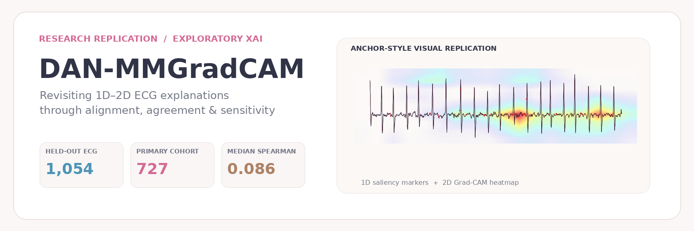
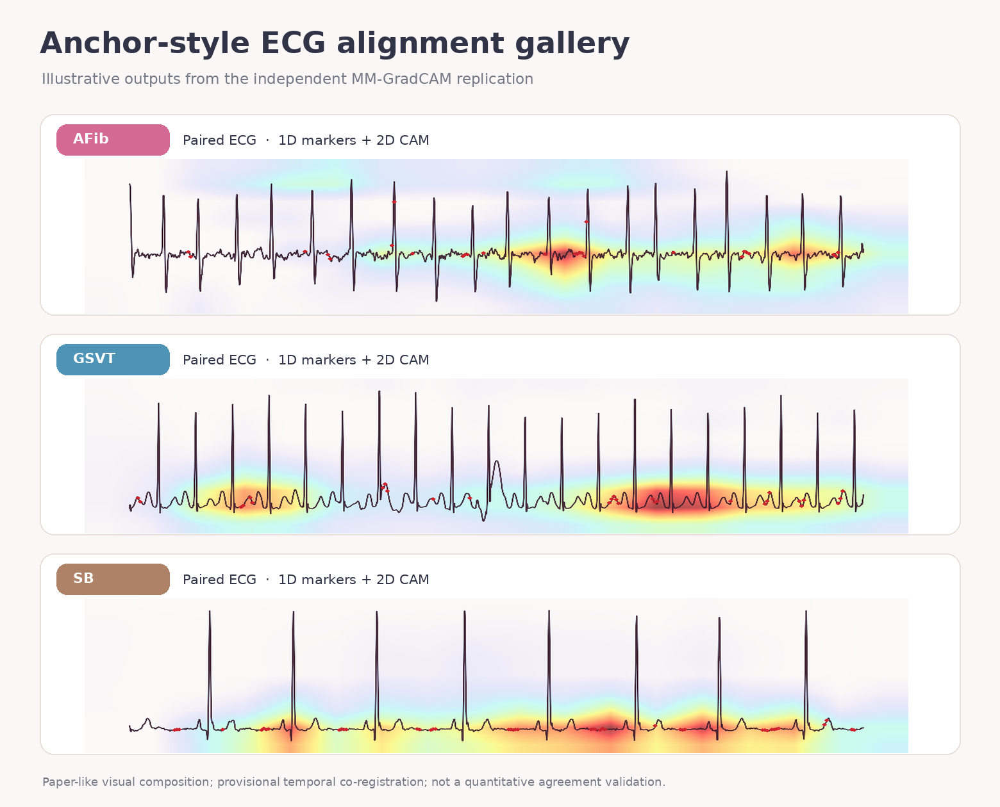
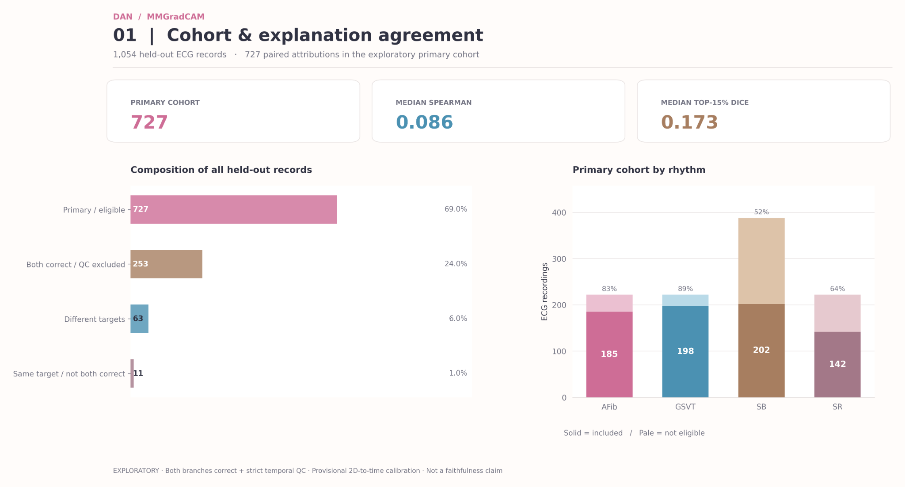
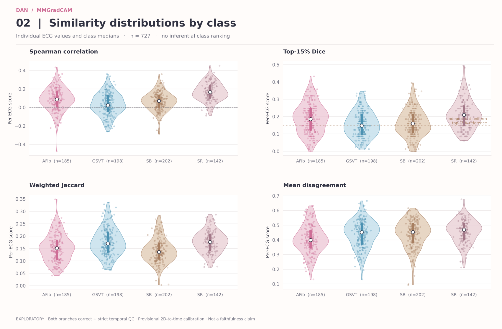
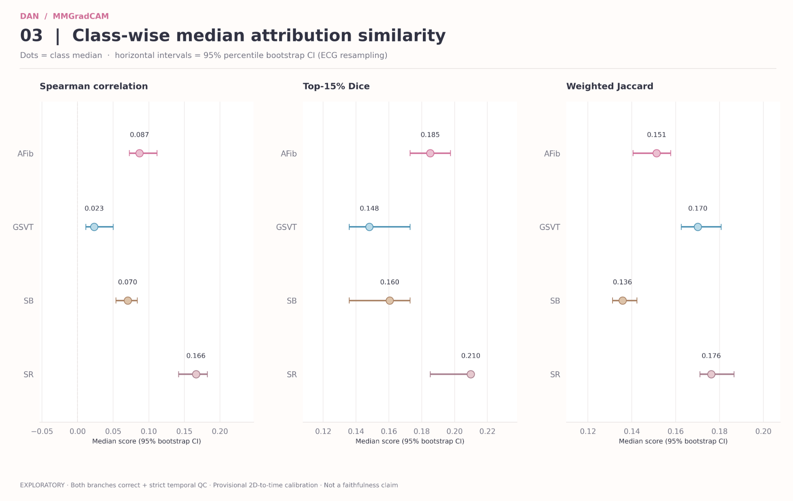
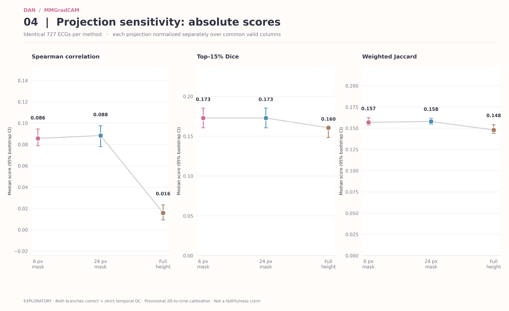
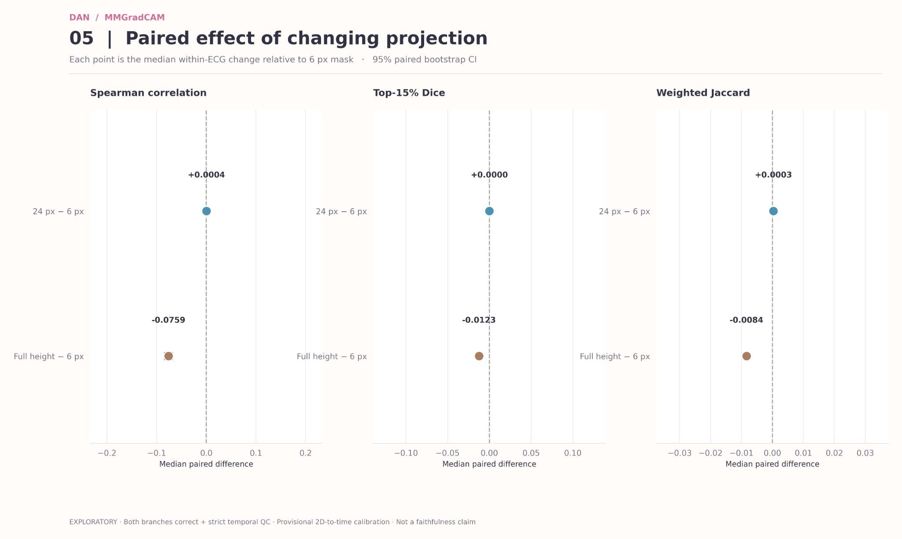
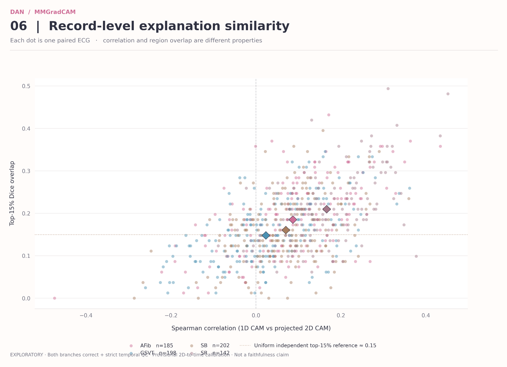
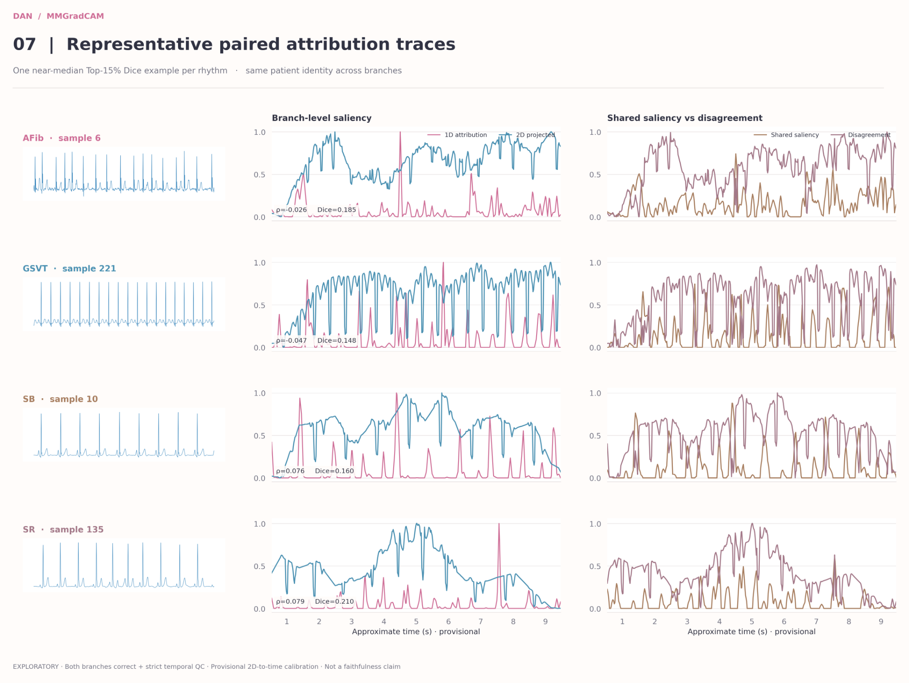

<div align="center">



# DAN-MMGradCAM · Anchor Paper Replication

**Independent replication of MM-GradCAM (1D + 2D ECG)**  
**+ exploratory alignment, attribution agreement and projection sensitivity**

[](#anchor-paper--attribution)
[](#exploratory-findings)
[](#scope-and-limitations)
[](scripts/)

</div>

> **Project positioning.** This is an **independent implementation and visual replication** of the MM-GradCAM anchor study by **Murat Duranay et al. (2026)**, followed by new **exploratory, post-hoc** assessment of 1D–2D attribution correspondence. **Not an official author repository, not a pixel-identical reproduction, and not yet a validated new method.** All quantitative time-axis comparisons remain provisional pending direct verification of original image-rendering coordinates.

---

## From anchor reproduction to explanation reliability

| **1 — Anchor replication** | **2 — Exact alignment & QC** | **3 — DAN exploratory agreement** |
|:---|:---|:---|
| Independent 1D and 2D ECG branches, branch-level Grad-CAM and paper-like multimodal composition. | Pair the **same held-out ECG record** across branches; audit original signal/image correspondence and temporal assumptions. | Quantify shared versus differing attribution and test dependence on 2D-to-time projection choices. |

<div align="center">
  
  <sub>Actual research visualization outputs, not figures reproduced from the paper. 1D red saliency markers and 2D Grad-CAM heat fields share a displayed ECG image; quantitative temporal calibration remains provisional.</sub>
</div>

## What was replicated from the anchor paper?

The independent HPC experiment reproduced the **two separate ECG branches (signal/image), four-rhythm classification, their Grad-CAM maps, and the paper-style shared ECG display**. We also performed **exact same-record pairing** before producing 1,054 multimodal overlays. The original publication did **not** require our subsequent exploratory agreement metrics; they are a separate extension.

| Test classification accuracy | Anchor paper (published) | Independent replication (this project) |
|---|---:|---:|
| 1D signal CNN | **93.07%** | **94.78%** |
| 2D image CNN | **97.44%** | **96.68%** |

The independent runs were **not bitwise identical** to the authors' trained models, preprocessing, splits or rendered images. These performance values are **descriptive** and should not be interpreted as superiority over the anchor; the per-branch reproduction does **not** itself validate temporal attribution correspondence.

## At a glance

| Test cohort | Correct in both branches | Strict waveform QC | Exploratory primary cohort |
|:---:|:---:|:---:|:---:|
| **1,054 ECGs** | **980** | **779** | **727** |

**Primary cohort composition:** AFib **185** · GSVT **198** · SB **202** · SR **142**.  
**Important:** Strict QC and correct prediction are both required for the primary sample; **63** test records have different prediction targets across branches and are not compared as if they explained the same target.

### Exploratory findings (727 paired ECGs)

| Metric | Mean | Median |
|---|---:|---:|
| Spearman attribution correlation | 0.0830 | **0.0856** |
| Top-15% Dice overlap | 0.1769 | **0.1728** |
| Weighted Jaccard | 0.1607 | **0.1568** |
| Mean shared-saliency operator | 0.1507 | 0.1516 |
| Mean attribution difference | 0.4340 | 0.4442 |

These describe low **observed cross-representation attribution correspondence under the specified projection**, **not** poor model performance, clinical validity, or causal/faithfulness conclusions. The independent uniform top-15% overlap reference of ~0.15 is descriptive, **not** a structure-preserving statistical null test.

### Figure gallery — experimental results

| Cohort overview | Distribution by arrhythmia class |
|:---:|:---:|
| [](figures/results/01_overview.png) | [](figures/results/02_distribution_by_class.png) |

| Class-wise bootstrap intervals | Projection sensitivity |
|:---:|:---:|
| [](figures/results/03_class_medians_ci.png) | [](figures/results/04_projection_median_scores.png) |

| Within-ECG paired changes | Record-level attribution similarity |
|:---:|:---:|
| [](figures/results/05_projection_paired_changes.png) | [](figures/results/06_spearman_vs_dice_scatter.png) |

<div align="center">
<a href="figures/results/07_representative_ecg_traces.png"></a>
<br><sub>Four representative paired signals and their provisional 1D/2D saliency projection; not a substitute for a calibrated temporal registration test.</sub>
</div>

### Projection robustness (same 727 ECGs)

| Median metric | 6 px waveform mask | 24 px waveform mask | Full-height mean |
|---|---:|---:|---:|
| Spearman | **0.0856** | 0.0883 | 0.0157 |
| Top-15% Dice | **0.1728** | 0.1728 | 0.1605 |
| Weighted Jaccard | **0.1568** | 0.1579 | 0.1479 |

Widening the waveform mask from 6 to 24 px caused little change in these descriptive statistics; replacing the waveform-restricted projection with full-height averaging reduced the median rank correlation. Projection strategy is **not** equivalent to model explanation quality; quantitative conclusions remain exploratory.

## Reproducible code — curated, no ECG data

```text
scripts/
├── verify_ecg_gradcam_pairs.py              # exact same-record matching
├── mmgradcam_alignment_preflight.py         # geometry and pixel checks
├── run_ecg_temporal_alignment_provisional.py # provisional 1D-to-2D coordinates
├── validate_ecg_temporal_alignment_hpc.py   # independent signal/image correspondence audit
├── run_anchor_mmgradcam_paper_figure.py     # anchor-style visual composition
├── run_all_mmgradcam_alignment.py           # batch of paired visual overlays
├── run_dan_module1_exploratory.py           # quantitative agreement/disagreement
├── run_dan_module1_projection_sensitivity.py # 6 px / 24 px / full-height
└── plot_dan_module1_paper_figures.py        # seven paper-style figures
figures/
├── branding/ and alignment/                 # curated public visual examples
└── results/                                 # seven aggregate research figures
docs/
├── REPRODUCIBILITY.md
├── DATA_PROVENANCE.md
└── SCOPE_AND_LIMITATIONS.md
tools/audit_repository.py                    # pre-push exclusion checker
```

This repository intentionally excludes **all raw ECG files, numerical per-record data, generated heatmap arrays, saved CNN weights, HPC logs, private credentials, and the full author repository**. It is a **curated post-training replication and evaluation code release**. To reproduce end-to-end model training, follow the anchor authors' original model repositories and independently rebuild the required arrays/manifest files. See [Reproducibility instructions](docs/REPRODUCIBILITY.md).

## Quick start (with datasets and precomputed outputs already available locally)

```bash
python -m pip install -r requirements.txt

# Inside a workspace containing the prerequisite splits/, data/ and results/:
python scripts/verify_ecg_gradcam_pairs.py
python scripts/validate_ecg_temporal_alignment_hpc.py --self-test
python scripts/run_all_mmgradcam_alignment.py --figures representative

# Post-hoc Module 1 (requires independent timing-audit CSV):
python scripts/run_dan_module1_exploratory.py --qc-figures 16 --out results/dan_module1_full_release
python scripts/run_dan_module1_projection_sensitivity.py \
  --pilot results/dan_module1_full_release/module1_primary_exploratory.csv \
  --out results/dan_module1_sensitivity_release
python scripts/plot_dan_module1_paper_figures.py \
  --module results/dan_module1_full_release \
  --sensitivity results/dan_module1_sensitivity_release \
  --out results/dan_module1_visuals_release
```

`run_dan_module1_exploratory.py` defaults to the historical timing-audit location. For a new workspace, pass `--validation <your-audit-output>/temporal_alignment_validation.csv` to match your actual audit location. The scripts also expect the **same local relative file structure** documented in [docs/REPRODUCIBILITY.md](docs/REPRODUCIBILITY.md). Never interpret positional within-class matching as verified patient identity.

## Trained models, HPC scripts and results

**[Download independently trained 1D/2D CNN weights from GitHub Releases](https://github.com/dwiharyani/dan-mmgradcam-anchor-replication/releases/tag/v0.2.0-hpc-trained-models)** · [HPC code + result documentation](docs/HPC_MODELS_AND_RESULTS.md) · [Aggregate JSON reports](reports/)

The model assets are **not the anchor authors’ original weights**. Only curated HPC scripts and aggregate figures/reports are included; **the ECG dataset and record-level outputs are excluded**.

## Anchor paper & attribution

**Primary anchor:** Murat Duranay, F., Murat, E., Yıldırım, Ö., *et al.* (2026). [*MM-GradCAM: an improved multimodal GradCAM method with 1D and 2D ECG data for detection of cardiac arrhythmia*](https://doi.org/10.1038/s41598-026-38654-w). *Scientific Reports*, **16**, Article 7919.

**Original authors' code:** [Main MM-GradCAM repository](https://github.com/FatmaMurat/MM_GradCAM) · [1D CNN](https://github.com/FatmaMurat/MM_GradCAM-1DCNN) · [2D CNN](https://github.com/FatmaMurat/MM_GradCAM-2DCNN) · [MM-GradCAM Fusion](https://github.com/FatmaMurat/MM_GradCAM-Fusion).  
**Original ECG dataset:** [Chapman–Shaoxing ECGData.zip on Figshare](https://figshare.com/articles/dataset/ECGData_zip/8361860).  
**Author-provided 2D images:** [Kaggle — imagedata-label2](https://www.kaggle.com/datasets/fatmamurat/imagedata-label2).

We acknowledge the original authors for the anchor MM-GradCAM study and architecture. All overlays and analytical figures in this repository derive from the **independent experiments** documented here, rather than copied figures from the original paper.

## Scope and limitations

- **Visual replication ≠ pixel-identical figure reconstruction:** independent training, preprocessing and rendering can differ from original runs.
- **Exploratory time calibration:** the mapping of original 2D ECG image x coordinates (provisionally x = 58…1021) to 0–10 s is not yet independently confirmed using the original image-generation code.
- **Low native 2D CAM resolution:** original Grad-CAM feature map **9 × 18** interpolated to **300 × 600**; image-space precision cannot be interpreted as feature-map precision.
- **Selection bias:** the primary agreement subset includes only correct predictions for both branches and strict temporal QC.
- **No stability/faithfulness claim:** prediction-preserving perturbation, deletion tests and structure-aware null controls are planned, **not** present validated results.

**Research status:** **Anchor visual reproduction completed; DAN Module 1 exploratory analysis and 727-case projection sensitivity completed.** Further temporal calibration and validation are required before stronger interpretive claims.

---

<sub>Figures use the research palette: pastel pink · light blue · soft brown. See [license & attribution notice](LICENSE_NOTICE.md) before reusing code or figures.</sub>

## Reproduce the exact 1,054-ECG held-out test set

To reproduce the **independent anchor MM-GradCAM** evaluation, use the exact record-aligned test manifest (AFib 222, GSVT 222, SB 388, SR 222) and the same trained checkpoints. The original ECG datasets are **not hosted here**.

- [Exact 1,054-record test manifest](reproducibility/test_split_1054.csv)
- [Step-by-step guide for collaborators](docs/FRIEND_REPRODUCE_TESTSET.md)
- [Trained models (GitHub Release v0.2.0)](https://github.com/dwiharyani/dan-mmgradcam-anchor-replication/releases/tag/v0.2.0-hpc-trained-models)

Numerical preprocessing, label mapping and inference settings must also match; the fixed split alone does not guarantee identical metrics.
